# Energy Overview Card

[](https://my.home-assistant.io/redirect/marketplace_repository/?owner=hoentaex&repository=ha-energy-overview-card&category=plugin)
[](https://github.com/hoentaex/ha-energy-overview-card/releases/latest)
[](https://github.com/hoentaex/ha-energy-overview-card/actions/workflows/validate.yml)
[](https://github.com/hoentaex/ha-energy-overview-card/actions/workflows/hacs.yml)
[](LICENSE)

**[Deutsch](#deutsch) · [English](#english)**

| Hell / Light | Dunkel / Dark |
|---|---|
| 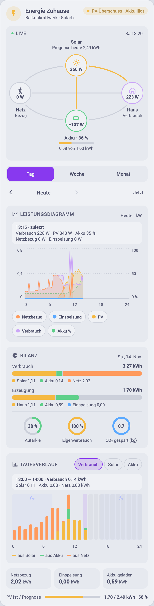 | 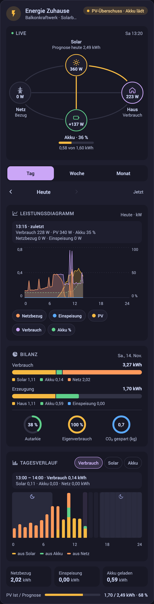 |

---

## Deutsch

Lovelace-Karte für eine **PV-Anlage mit Heimspeicher**: Live-Energiefluss, Bilanz und Verlauf
(Tag / Woche / Monat) in **einer** Karte.

Auf einen Blick: Woher kommt gerade Strom, wohin geht er, wie voll ist der Akku – und für einen wählbaren Zeitraum:
wie viel wurde verbraucht und erzeugt, woher kam der Verbrauch, wohin ging die Erzeugung, wie autark war das Haus.

Aufbau und Look orientieren sich an den Karten von [juju35](https://github.com/juju35). Schwesterprojekt:
[Tibber Battery Card](https://github.com/hoentaex/ha-tibber-battery-card).

> [!WARNING]
> **Privates Hobbyprojekt.** Die Karte ist für meine eigene Installation entstanden und wird in der Freizeit gepflegt.
> Es gibt keine Gewährleistung und keinen Support: **Die Nutzung erfolgt auf eigene Gefahr.**
> Die Karte liest nur Zustände und Statistiken aus Home Assistant – sie schaltet nichts.

### Was die Karte macht – und was nicht

- **Live:** Energiefluss zwischen Solar, Netz, Haus und Akku (aktive Flüsse animiert, Tempo nach Leistung),
  Ladestand mit kWh, Status-Pill („Netz versorgt Haus“, „PV-Überschuss · Akku lädt“, „PV deckt Haus“,
  „Akku versorgt Haus“, „Einspeisung“). Vier Darstellungen zur Wahl, siehe [Energiefluss-Darstellungen](#energiefluss-darstellungen).
- **Zeitraum Tag / Woche / Monat** (unbegrenzt zurückblättern): Bilanz mit Verbrauch (aus Solar / Akku / Netz) und
  Erzeugung (ins Haus / in den Akku / Einspeisung), Autarkie, Eigenverbrauch, CO₂ gespart.
- **Leistungsdiagramm** des Tages (Netzbezug, Einspeisung, PV, Verbrauch, Akku-Ladestand) mit Fadenkreuz.
- **Verlauf** als Säulen: Verbrauch (mit Nachtbereichen), Solar (heute mit Prognose) und Akku (Ladung nach oben,
  Entladung nach unten, Ladestand-Linie).
- **Nicht enthalten:** Steuerlogik, Kosten und Tarife – dafür gibt es die Tibber Battery Card.

| Woche | Monat |
|---|---|
| 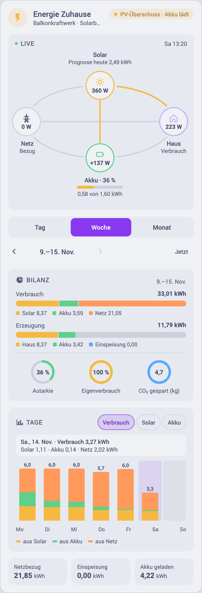 | 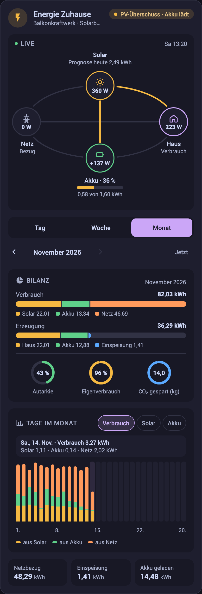 |

### Was du brauchst

| Baustein | Wofür | Pflicht? |
|---|---|---|
| Home Assistant 2024.8 oder neuer | | ja |
| Eingerichtetes **Energie-Dashboard** (Netz, Solar, Akku) **oder** eigene Energie-Sensoren mit Statistik (`state_class: total` / `total_increasing`) | Bilanz, Verlauf | ja |
| Leistungssensoren in W oder kW: PV, Netz, Akku, Hausverbrauch | Live-Fluss, Status, Leistungsdiagramm | empfohlen – ohne Angabe nimmt die Karte die Leistungssensoren aus dem Energie-Dashboard |
| Ladestand-Sensor in % und Akkukapazität | Akku-Knoten, Ladestand-Linie | empfohlen |
| Solar-Prognose im Energie-Dashboard (z. B. [Forecast.Solar](https://www.home-assistant.io/integrations/forecast_solar/)) | Prognose heute | optional |
| Ein Energie-Sensor für die Akkuladung **aus dem Netz** | Aufteilung der Ladung in PV / Netz | optional |

> [!IMPORTANT]
> **Hausverbrauch nur, wenn er wirklich nur das Haus misst.** Viele selbst gebaute „Verbrauch“-Sensoren rechnen
> Netzbezug + PV und zählen dabei die **Akkuladung aus dem Netz** als Hausverbrauch mit. Dann geht der Fluss nicht auf
> (Netz + PV ≠ Haus + Akku) und die Netzladung steht im Verlauf doppelt. Im Zweifel `house_power_entity` und
> `consumption_stat` weglassen – die Karte rechnet den Hausverbrauch dann aus der Bilanz, und alles geht auf.

Fehlt eine Entity, ist sie `unavailable` oder gibt es keine Statistik, blendet die Karte den Wert oder Abschnitt aus
bzw. zeigt „–“ – sie bricht nie komplett.

### Woher die Zahlen kommen

- **Live** aus den Zuständen der Leistungssensoren. Netz: + Bezug / − Einspeisung (oder zwei getrennte Sensoren),
  Akku: + laden / − entladen. Fehlt ein Hausverbrauch-Sensor, rechnet die Karte PV + Bezug − Einspeisung + Entladung − Ladung.
- **Tag / Woche / Monat** aus der Langzeit-Statistik (`recorder/statistics_during_period`, stündlich bzw. täglich),
  standardmäßig mit den Quellen des Energie-Dashboards. Jede Quelle lässt sich per `*_stat` überschreiben – auch
  täglich zurückgesetzte `utility_meter` funktionieren. Die Tagesgrenzen folgen der **Zeitzone des Home-Assistant-Servers**;
  Tage mit Zeitumstellung haben 23 bzw. 25 Stunden.
- **Aufteilung** je Stunde bzw. Tag (alles ≥ 0):

  ```
  PV → Akku     = Akku geladen − Akku geladen aus Netz
  PV → Haus     = Solar − Einspeisung − PV → Akku
  Haus ← Akku   = Akku entladen
  Haus ← Netz   = Verbrauch − PV → Haus − Haus ← Akku
  Autarkie      = (PV → Haus + Haus ← Akku) / Verbrauch
  Eigenverbrauch = (Solar − Einspeisung) / Solar
  CO₂ gespart   = (Solar − Einspeisung) × co2_factor
  ```

  Ohne `consumption_stat` wird der Verbrauch hochgerechnet: Solar + Bezug − Einspeisung + Entladung − Ladung.
- **Leistungsdiagramm** aus der History des Tages, gemittelt auf 5 oder 15 Minuten; ist der Tag älter als die
  Recorder-Aufbewahrung, aus der 5-Minuten- bzw. Stunden-Statistik.
- **Prognose** (nur heute) über `energy/solar_forecast` aus den Prognose-Einträgen des Energie-Dashboards.
- **Nachtbereiche** heute aus `sun.sun`, für andere Tage aus dem Standort von Home Assistant berechnet.
- Abfragen werden zwischengespeichert: vergangene Zeiträume nur einmal, der aktuelle alle 5 Minuten bzw. zur vollen Stunde.

### Installation

**Über den Marketplace (HACS):**

[](https://my.home-assistant.io/redirect/marketplace_repository/?owner=hoentaex&repository=ha-energy-overview-card&category=plugin)

oder von Hand: **Marketplace → ⋮ → Benutzerdefinierte Repositories** → `https://github.com/hoentaex/ha-energy-overview-card`,
Typ **Dashboard** → *Energy Overview Card* installieren → Browser neu laden.

**Manuell:** `ha-energy-overview-card.js` aus dem [letzten Release](https://github.com/hoentaex/ha-energy-overview-card/releases/latest)
nach `/config/www/` kopieren, unter **Einstellungen → Dashboards → ⋮ → Ressourcen** `/local/ha-energy-overview-card.js`
als **JavaScript-Modul** eintragen, Browser neu laden.

### Konfiguration

Minimal – alles kommt aus dem Energie-Dashboard:

```yaml
type: custom:energy-overview-card
```

Vollständig (Beispiel mit Balkonkraftwerk und Anker Solarbank 2 E1600 AC):

```yaml
type: custom:energy-overview-card
name: Energie
subtitle: Balkonkraftwerk · Solarbank 2 E1600 AC
solar_power_entity: sensor.pv_power_from_solar
grid_import_power_entity: sensor.pv_power_from_grid
grid_export_power_entity: sensor.einspeisung_positiv
battery_power_entity: sensor.solarbank_2_e1600_ac_akkuleistung
soc_entity: sensor.pv_batterie_soc
capacity_kwh: 1.6
battery_grid_charge_stat: sensor.akkuladung_von_netz_energy_daily
forecast_today_entity: sensor.energy_production_today
```

**Live-Werte**

| Option | Bedeutung | Standard |
|---|---|---|
| `solar_power_entity` | PV-Leistung (W / kW) | Leistungssensor aus dem Energie-Dashboard |
| `grid_power_entity` | Netzleistung, + Bezug / − Einspeisung | Energie-Dashboard |
| `invert_grid` | Vorzeichen der Netzleistung umdrehen | `false` |
| `grid_import_power_entity` / `grid_export_power_entity` | Bezug und Einspeisung als zwei Sensoren (statt `grid_power_entity`) | – |
| `battery_power_entity` | Akkuleistung, + laden / − entladen | Energie-Dashboard (dort + entladen, wird umgedreht) |
| `invert_battery` | Vorzeichen der Akkuleistung umdrehen | `false` |
| `house_power_entity` | Hausverbrauch | berechnet |
| `soc_entity` | Ladestand in % | – |
| `capacity_entity` / `capacity_kwh` | Akkukapazität in kWh | – |

**Statistik (Tag / Woche / Monat)** – leer = aus dem Energie-Dashboard; jeweils eine Statistik-ID oder eine Liste,
die addiert wird:

| Option | Bedeutung | Standard |
|---|---|---|
| `solar_stat` | Solar-Erzeugung | Solar `stat_energy_from` |
| `grid_import_stat` / `grid_export_stat` | Netzbezug / Einspeisung | Netz `stat_energy_from` / `stat_energy_to` |
| `battery_charge_stat` / `battery_discharge_stat` | Akku geladen / entladen | Akku `stat_energy_to` / `stat_energy_from` |
| `battery_grid_charge_stat` | davon aus dem Netz geladen (ist in `battery_charge_stat` enthalten) | – (dann zählt alle Ladung als PV) |
| `consumption_stat` | Hausverbrauch – wird der Hochrechnung vorgezogen | hochgerechnet |
| `forecast_today_entity` | Tagessumme der PV-Prognose (kWh) | Summe aus `energy/solar_forecast` |

**Darstellung**

| Option | Bedeutung | Standard |
|---|---|---|
| `name`, `subtitle`, `icon` | Titel, Untertitel, Icon | „Energie“, –, Blitz |
| `sections` | Reihenfolge / Auswahl: `header`, `flow`, `period`, `power`, `balance`, `history`, `footer` | alle |
| `history_view` | Verlauf beim Öffnen: `consumption`, `solar`, `battery` | `consumption` |
| `week_mode` | `calendar` (Mo–So) oder `rolling` (letzte 7 Tage) | `calendar` |
| `power_resolution` | Raster des Leistungsdiagramms in Minuten: `5` oder `15` | `15` |
| `flow_style` | Live-Fluss: `ellipse`, `house` (Haus-Szene), `sankey` (Energiebänder), `ring` (Haus-Ring) | `ellipse` |
| `flow_background` | Hintergrund von Bändern und Ring: `none` oder `weather` (Wetterhimmel) | `none` |
| `weather_entity` | `weather.*`-Entity für den Himmel | – (klarer Himmel) |
| `threshold_w` | ab wie viel Watt ein Fluss als aktiv gilt (Linien, Status) | `10` |
| `co2_factor` | kg CO₂ je kWh | `0.4` |
| `animations` | Flussanimation (respektiert `prefers-reduced-motion`) | `true` |
| `animate_by_power` | Animationstempo nach Leistung | `true` |
| `popup` | nur Mini-Karte: Hauptkarte als Dialog (`false` = darunter aufklappen) | `true` |
| `language` | `de` / `en` | Sprache von Home Assistant |

**Farben** lassen sich per Theme oder `card_mod` über CSS-Variablen ändern: `--eoc-pv-color` (#f5b942),
`--eoc-battery-color` (#5fd08a), `--eoc-import-color` (#ff9a5c), `--eoc-export-color` (#5aa9ff), `--eoc-grid-charge-color` (#5aa9ff, Netz lädt Akku),
`--eoc-house-color` (#cba6f7), `--eoc-forecast-color` (#94e2d5), `--eoc-night-color` (rgba(180,190,254,.11)),
`--eoc-night-icon-color` (#b4befe), `--eoc-accent-color` (Standard: `--primary-color`). Alles andere kommt aus dem Theme.

### Energiefluss-Darstellungen

`flow_style` wählt, wie der Live-Fluss aussieht. Die Ellipse bleibt der Standard.

| `house` – Haus-Szene | `sankey` – Energiebänder | `ring` – Haus-Ring |
|---|---|---|
| 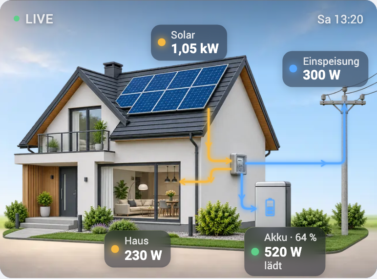 | 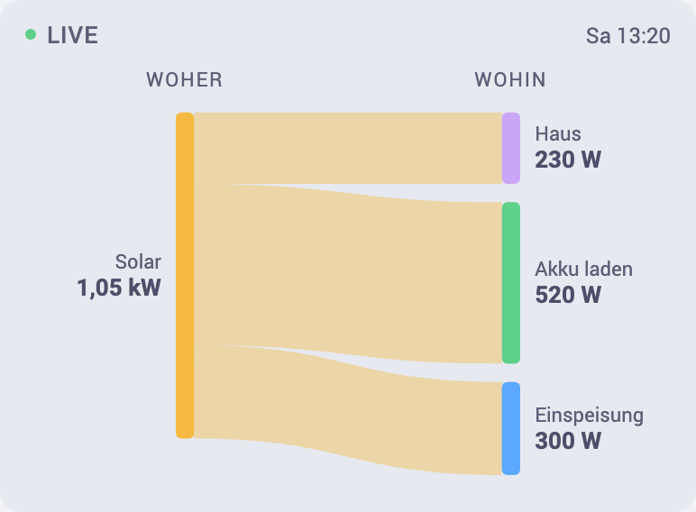 | 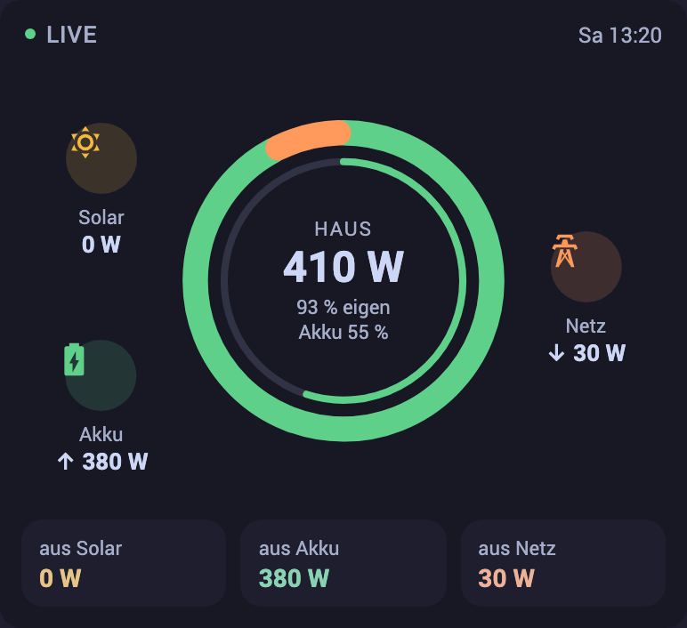 |
| 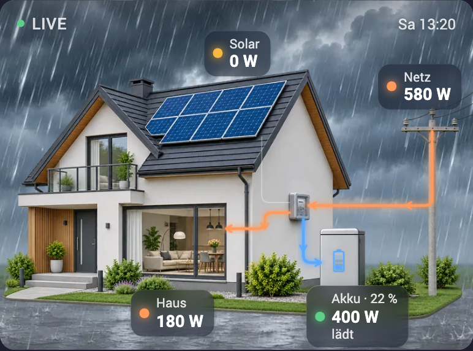 | | 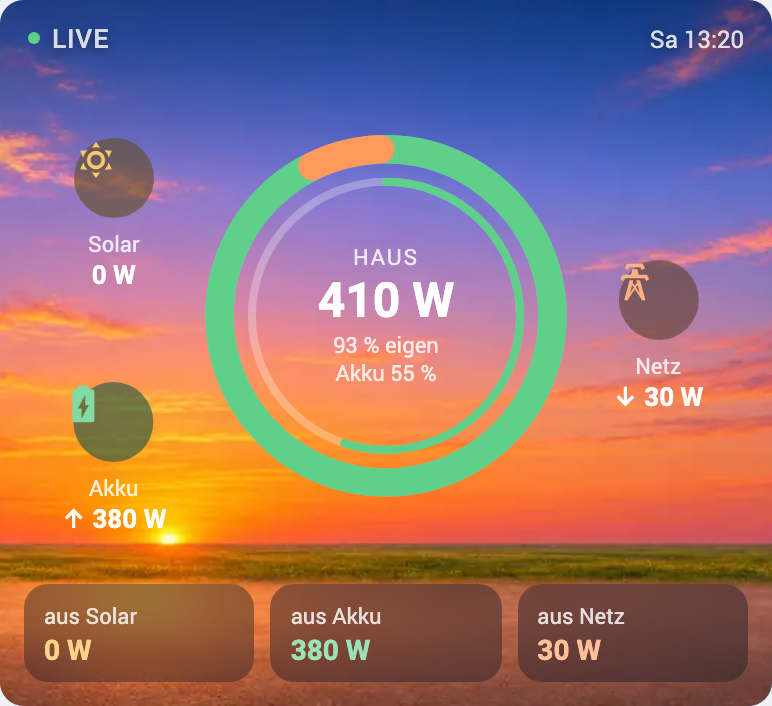 |
| 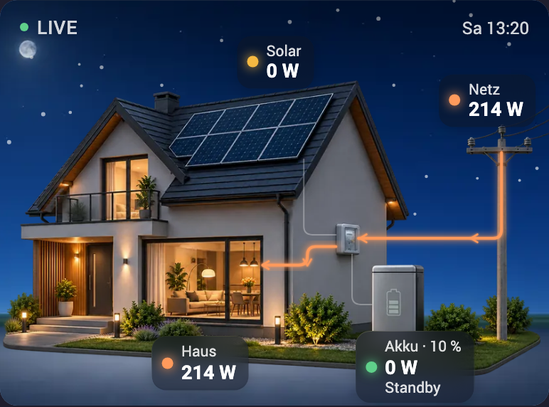 | | |

- **`ellipse`** (Standard): vier Knoten auf einer Ellipse, aktive Flüsse animiert.
- **`house`**: 3D-Haus auf einem Wetterhimmel. Alle Leitungen laufen über den Zählerkasten, waagerecht und senkrecht
  mit runden Ecken; aktive Leitungen leuchten in der Farbe ihres Flusses, mit Lichtimpuls und Pfeilen in Flussrichtung.
  Die Leitung ins Haus nimmt die Farbe der Quelle an, die das Haus gerade am meisten versorgt. Das Batteriesymbol am
  Akku pulsiert blau beim Laden und grün beim Entladen, die Balken zeigen den Ladestand. Ab der Dämmerung erscheint
  das Haus mit beleuchteten Fenstern.
- **`sankey`**: links woher (Solar, Akku, Netz), rechts wohin (Haus, Akku laden, Einspeisung); die Bandbreite
  entspricht der Leistung, beide Seiten sind gleich hoch.
- **`ring`**: großer Ring mit dem Hausverbrauch, Segmente nach Quelle (Solar, Akku, Netz), innen der Ladestand, dazu
  der Anteil eigener Energie und die Aufteilung als Kacheln.

**Wetterhimmel:** Die Haus-Szene steht immer auf einem Himmel; Bänder und Ring mit `flow_background: weather`.
Der Himmel folgt `weather_entity` (klar, bewölkt, Regen, Schnee, Nebel) und dem Sonnenstand aus `sun.sun`:
Tag, Sonnenuntergang (−4° bis 8°) und Nacht. Regen und Schnee fallen leicht animiert, nachts funkeln Sterne
(bei „Bewegung reduzieren“ steht alles still). Ohne `weather_entity` ist der Himmel klar.

> [!NOTE]
> Haus- und Himmelsbilder sind in die JS-Datei eingebettet (der Marketplace installiert nur diese eine Datei).
> Die Karte ist dadurch rund 500 KB groß.

### Verlauf

| Verbrauch | Solar | Akku |
|---|---|---|
| 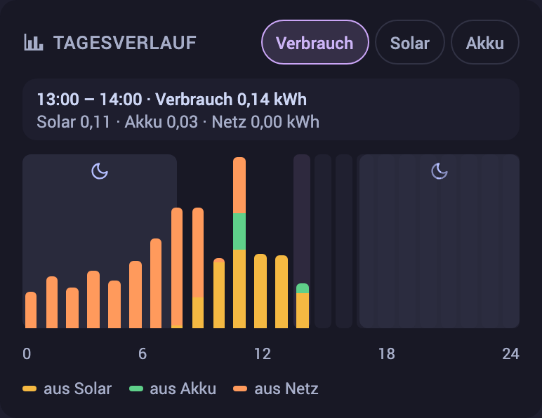 | 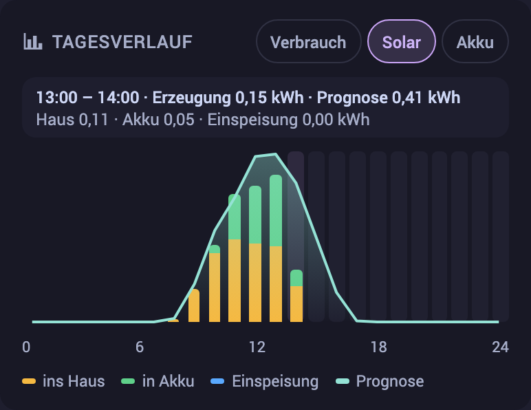 | 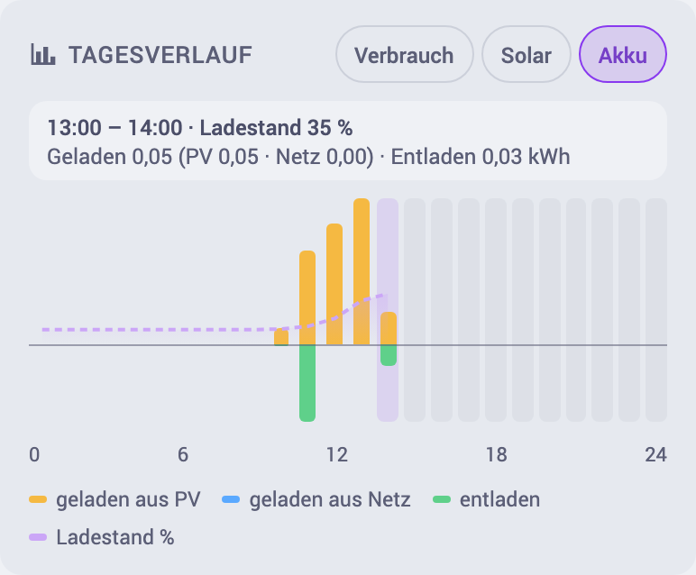 |
| aus Solar / Akku / Netz, nachts mit Mond | ins Haus / in den Akku / Einspeisung, heute mit Prognose | Ladung oben (PV / Netz), Entladung unten, Ladestand |

Jede Säule ist ein Button: Hover, Fokus oder Antippen zeigt die Werte in der Zeile darüber. In der Wochenansicht
stehen die Werte über (und beim Akku die Entladung unter) den Säulen; im Monat sind künftige Tage blasse Platzhalter.

### Mini-Karte

`custom:energy-overview-mini-card` zeigt eine Zeile: Ladestand-Ring, Name, Status, PV- und Netzleistung und die
Autarkie von heute. Der Button rechts öffnet die Hauptkarte als Dialog (Escape oder Klick daneben schließt ihn);
mit `popup: false` klappt sie stattdessen darunter auf. Sie nimmt dieselben Optionen wie die Hauptkarte.

```yaml
type: custom:energy-overview-mini-card
name: Energie
# … dieselben Optionen wie die Hauptkarte
```

| Mini-Karte | Dialog |
|---|---|
| 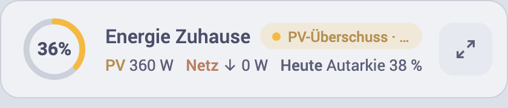<br>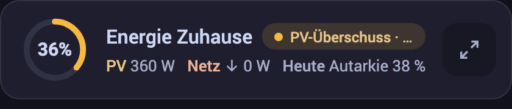 | 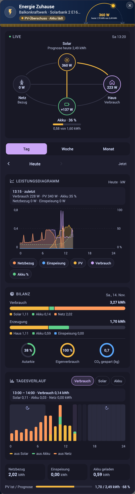 |

### Visueller Editor

Beide Karten lassen sich komplett im visuellen Editor einrichten: Entity-Auswahl für die Live-Werte, Statistik-Auswahl
für die Zeiträume (leer = aus dem Energie-Dashboard), Abschnitte, Darstellung und ein Bereich **Erweitert**.
Optionen mit Standardwert landen nicht im YAML. Eine neue Karte übernimmt die Leistungssensoren aus dem
Energie-Dashboard und sucht selbst einen Ladestand-Sensor, die Tagesprognose und eine Wetter-Entity.

---

## English

A Lovelace card for a **PV system with a home battery**: live energy flow, balance and history
(day / week / month) in **one** card.

> [!WARNING]
> **This is a private hobby project**, built for my own installation and maintained in spare time. It comes without
> any warranty or support: **use it at your own risk.** The card only reads states and statistics from Home Assistant –
> it does not switch anything.

**What it shows:** the live flow between solar, grid, home and battery with a status pill; for a day, week or month
(page back without limit) the balance of consumption (from solar / battery / grid) and production (to home / battery /
export), self-sufficiency, self-consumption and CO₂ saved; the day's power chart with a crosshair; and a history of
consumption (with night blocks), solar (with today's forecast) and battery (charge up, discharge down, state-of-charge
line). **Not included:** control logic, costs and tariffs.

**Flow styles:** `flow_style` picks the live flow: `ellipse` (default), `house` (a 3D house on a weather sky; all lines
run through the meter box, horizontal and vertical with round corners, glowing in the colour of their flow with arrows;
the battery symbol pulses blue while charging and green while discharging; lit windows from dusk), `sankey` (energy
bands from the sources to the consumers) or `ring` (home consumption by source with the state of charge inside).
The house scene always stands on the sky; bands and ring take it with `flow_background: weather`. The sky follows
`weather_entity` (clear, cloudy, rain, snow, fog) and the sun's elevation from `sun.sun` (day, sunset, night), with
light rain, snow and twinkling stars. The images are embedded in the JS file, which makes it about 500 KB.

**Home consumption:** only set `house_power_entity` / `consumption_stat` when the sensor measures the home alone.
Sensors built as grid import + PV often count battery charging from the grid as home consumption; then the flow does
not add up. Leave both out and the card takes the home from the balance.

**You need:** Home Assistant 2024.8+ and the **Energy dashboard** set up (or your own energy sensors with statistics).
Power sensors, a state-of-charge sensor and the battery capacity are recommended; without power sensors the card uses
the ones from the Energy dashboard. Anything missing or unavailable is hidden or shown as "–".

**Where the numbers come from:** live values from the power sensors (grid + import / − export, battery + charging /
− discharging); periods from the long-term statistics with the Energy dashboard's sources, each overridable through a
`*_stat` option; day boundaries follow the **Home Assistant server's time zone** (23 / 25 hours on the days the clocks
change). The split per hour or day is the formula block above; without `consumption_stat` consumption is estimated
as solar + import − export + discharge − charge. The power chart uses the day's history (5-minute or hourly statistics
once it is older than the recorder keeps), the forecast `energy/solar_forecast`, the night blocks `sun.sun` and the
home location.

**Install** through the Marketplace (HACS) as a custom repository of type *Dashboard*, or copy
`ha-energy-overview-card.js` from the latest release to `/config/www/` and add it as a JavaScript module resource.

**Configure** with the options in the tables above (all names are the same in English). Minimal config:

```yaml
type: custom:energy-overview-card
```

**Mini card:** `custom:energy-overview-mini-card` takes the same options and shows one row (ring, name, status, PV,
grid, today's self-sufficiency); its button opens the main card as a dialog (`popup: false` expands it below instead).

**Visual editor:** both cards can be set up entirely in the UI editor; new cards take the power sensors from the
Energy dashboard and find a state-of-charge sensor, today's forecast and a weather entity by themselves.

## Development

```bash
npm install
npm run check        # Biome lint, build, syntax check
npm test             # unit tests (node:test)
npm run demo         # demo page with a simulated installation on http://127.0.0.1:8769/demo/
npm run screenshots  # README screenshots (Playwright)
```

Releases: bump `version` in `package.json`, add its `CHANGELOG.md` section, push a tag `vX.Y.Z`.

## License

[MIT](LICENSE)
